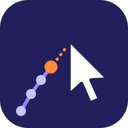
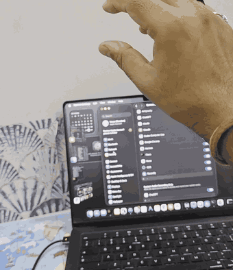
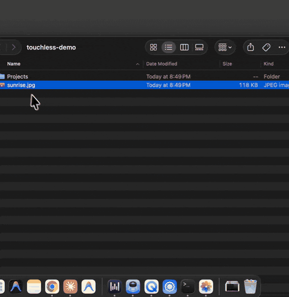
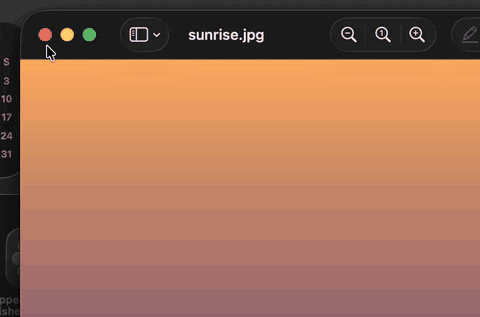
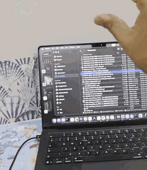
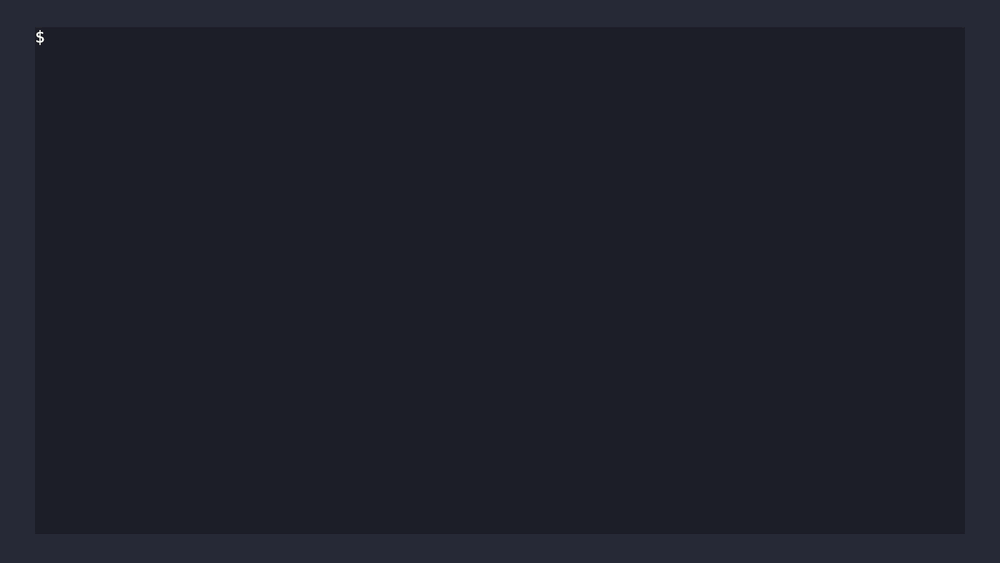

<p align="center"></p>

<h1 align="center">touchless-mac: control your Mac with your hand</h1>

<p align="center"><strong>Point to move the cursor. Pinch to click. Wave to switch apps.</strong><br>
It runs on the camera already in your Mac: no extra hardware, no cloud, nothing leaves your computer. Written in Rust, and built chapter by chapter as a beginner's Rust tutorial.</p>

<p align="center"><a href="#quick-start">Quick start</a> · <a href="#gestures">Gestures</a> · <a href="#learn-rust-with-it">Learn Rust with it</a> · <a href="#how-it-works">How it works</a> · <a href="#faq">FAQ</a></p>

<p align="center">
<a href="LICENSE"></a>


<a href="https://github.com/qualixar/touchless-mac/stargazers"></a>
</p>

<p align="center"><br><sub>Real: filmed on a phone while the app ran. A double pinch in the air opens a folder, then a thumb-to-ring pinch scrolls it.</sub></p>

## See it work

| Double pinch opens a photo | Pinch the red button: the window closes | Thumb + ring finger scrolls |
|:---:|:---:|:---:|
|  |  |  |
| screen recording of a real run | screen recording of a real run | filmed on a phone |


> **If this project is useful to you, please star it.** Stars are how other people find it.

## Quick start

**Install in one line** (Apple Silicon Mac; the ready-made build with the hand models included):

```sh
curl -fsSL https://raw.githubusercontent.com/qualixar/touchless-mac/main/install.sh | bash
touchless-mac doctor     # checks the models, camera and permissions, and opens the right Settings page if one is off
touchless-mac            # starts it; the first run asks you to point at four corners
```

Or with Homebrew:

```sh
brew install qualixar/tap/touchless-mac
```

The installer downloads the latest release, checks it against its SHA-256 fingerprint and puts `touchless-mac` in `~/.local/bin`; nothing needs `sudo`. Read [install.sh](install.sh) before you run it if you like; it's short. To remove it: `rm -rf ~/.local/share/touchless-mac ~/.local/bin/touchless-mac`.

macOS asks for two permissions for the app you start it from (usually Terminal):

1. **Camera.** Allow it.
2. **Accessibility**, which lets the app move the mouse and press keys.

If one is missing, the app says which one and opens that page of System Settings for you. It never crashes on it. `touchless-mac doctor` checks both at any time.

### Build it from source (the way the tutorial does)

You need Rust 1.85 or newer ([rustup.rs](https://rustup.rs); `rustup update` if unsure).

```sh
git clone https://github.com/qualixar/touchless-mac.git
cd touchless-mac
bash scripts/get-models.sh      # downloads the two hand models (about 8 MB) and checks their SHA-256
cargo run --release
```

<p align="center"></p>

The first build takes a few minutes while Cargo downloads and compiles the crates. On an Intel Mac this is the way to run it (the ready-made build is Apple Silicon only, and Intel is untested).

The ready-made build isn't signed by an Apple developer account yet. The installer and Homebrew handle that for you; if you download a release by hand in a browser, run `xattr -dr com.apple.quarantine <folder>` after unpacking.

### Check your install without a camera

This runs the same hand finder on Google's public MediaPipe sample photo and needs no permissions at all:

```sh
curl -sfLO https://storage.googleapis.com/mediapipe-tasks/gesture_recognizer/pointing_up.jpg
touchless-mac --selftest pointing_up.jpg          # installed app
cargo run --release -- --selftest pointing_up.jpg  # from source
```

You should see a line like `hand 1.00, index tip at (298, 29)`. Run the tests with `cargo test`.

## Calibration

*Commands below use `cargo run --release --` from a source checkout; with the installed app, type `touchless-mac` instead.*

On the first run the app asks you, out loud, to point at the four corners of the screen, one after another (about 13 seconds), so you can keep your eyes on the corners. It records where your index knuckle is for each corner and builds your personal reach box, so you can reach the whole screen, Dock included, without stretching your arm. The box is saved in `~/Library/Application Support/touchless-mac/` and reused next time.

```sh
cargo run --release -- --recalibrate    # measure again
cargo run --release -- --no-calibrate   # skip it and use the built-in box
```

## Cursor speed and scrolling

```sh
cargo run --release -- --speed 0.7       # slower, more precise (0.25 to 4; 1 is normal)
cargo run --release -- --speed 1.5       # faster, less hand movement
cargo run --release -- --invert-scroll   # if scrolling feels backwards to you
```

## Gestures

| Gesture | What happens | Same as |
|---|---|---|
| Point with your index finger | The cursor follows your index knuckle | moving the mouse |
| Pinch thumb and index finger | Click, where the cursor was a moment before your fingers closed | left click |
| Two quick pinches | Double-click: opens a file or an app | double click |
| Pinch thumb and middle finger | Right-click | right click |
| Touch thumb to ring finger, then move your hand up or down | Scroll; the page follows your hand | two-finger scroll |
| Open hand, wave right / left | Next / previous app | Cmd+Tab / Cmd+Shift+Tab |
| Open hand, wave up | Mission Control | Ctrl+Up |
| Hand leaves the picture | The cursor stays exactly where it was | letting go of the mouse |

The scroll pose was chosen from real recordings: a thumb-to-ring pinch appeared in under 1% of ordinary pointing frames, while "two fingers out" appeared in up to 82%, so it doesn't scroll by accident.

A pinch counts at under 2.5 cm between the fingertips, measured in 3D from the hand model, so tilting your hand doesn't change it. The cursor holds still while a pinch is down. Stop with Ctrl-C.

Air gestures aren't a touchscreen: the cursor still moves a little, and very small targets take practice.

## Learn Rust with it

This repository is the companion code for the YouTube tutorial **"Learn Rust by building a touchless Mac"**. Every chapter gives the app one new ability and teaches one Rust idea. Check out a tag to see the code exactly as it stood at the end of that chapter:

```sh
git checkout ch3-option
```

| Tag | Rust idea | The app gains |
|---|---|---|
| `ch1-cargo` | Cargo and crates | It sees the camera |
| `ch2-struct` | `struct`, `let` and `let mut` | The cursor follows your finger |
| `ch3-option` | `Option` | The hand leaves the picture, the cursor waits |
| `ch4-enum` | `enum` and `match` | Pinch, double pinch, right pinch and waves |
| `ch5-result` | `Result` and `?` | Clear messages for missing permissions and models |
| `ch6-calibrate` | Putting it together | Start-up calibration |

`examples/` has one tiny program per idea that needs no camera: `cargo run --example 01_cargo`, then `02_struct_mut`, `03_option`, `04_enum_match` and `05_result`. Each file has one commented-out line: uncomment it to see the real compiler error the video explains. `python/` has the Python versions shown first in the video, for comparison. `03_none_crash.py` crashes on purpose.

## How it works

Each camera picture goes through four steps:

1. **Find the palm.** Google's MediaPipe palm detector looks for a hand anywhere in the picture.
2. **Find 21 hand points.** The MediaPipe hand landmark model places 21 points on the hand: wrist, knuckles and fingertips. Once a hand is found, it's tracked from one picture to the next, so the palm search can be skipped.
3. **Steer.** Your index knuckle is mapped into your calibrated reach box, then smoothed with a One Euro filter, which calms small shaking but still follows fast moves.
4. **Act.** A gesture detector turns pinches and waves into clicks and shortcuts, which `enigo` sends to macOS.

Measured on an Apple M5 Pro: the palm search takes about 9 ms and tracking a hand already found about 1.5 ms. That's well under the 33 ms between camera pictures at 30 frames a second, so the camera sets the pace, not the code.

| File | What it does |
|---|---|
| `src/camera.rs` | Opens the camera and hands out pictures (`nokhwa`) |
| `src/hand.rs` | Runs the palm and hand models (`ort`, ONNX Runtime) and tracks the hand |
| `src/steer.rs` | Reach box and the One Euro filter: hand position to screen position |
| `src/gesture.rs` | `Gesture` enum, pinch debounce, double-click rule, wave detector |
| `src/mouse.rs` | Moves the cursor, clicks and presses shortcuts (`enigo`) |
| `src/error.rs` | One error type, with messages that say what to do |
| `src/calibrate.rs` | Four-corner calibration, saved between runs |
| `src/options.rs`, `src/selftest.rs` | Command-line options and the camera-free check |

## FAQ

**Does it send my camera to the internet?** No. Both models run on your Mac through ONNX Runtime, and the app makes no network requests while it runs. The models come inside the release download (or, from source, are fetched once from Hugging Face), checked against fixed SHA-256 fingerprints.

**Something isn't working?** Run `touchless-mac doctor`; it checks the models, the camera and both permissions and tells you what to fix. Still stuck? Open an issue and paste its output.

**Which Macs does it work on?** It's developed and tested on Apple Silicon with the built-in camera. Any camera macOS can see should work. Intel Macs are untested.

**Do I need to know Rust?** Not to use it: the one-line install is all you need. To learn Rust, follow the chapter tags with the video.

**Can it replace my mouse or trackpad?** For pointing, clicking, opening things and switching apps, yes. For pixel-precise work, a trackpad is still better.

**Is this an accessibility tool?** It can help anyone who would rather not touch the trackpad, but it hasn't been tested with assistive-technology users. Feedback in the issues is very welcome.

**Why Rust and not Python?** The video's first chapter answers it in full. In short: the compiler catches whole classes of mistakes before the program runs, and one small binary does the job without a Python environment.

## Credits

- Google MediaPipe hand models: the palm detector and the 21-point hand landmark model ([MediaPipe Hand Landmarker](https://developers.google.com/edge/mediapipe/solutions/vision/hand_landmarker)).
- OpenCV's ONNX conversions of those models ([`opencv/palm_detection_mediapipe`](https://huggingface.co/opencv/palm_detection_mediapipe), [`opencv/handpose_estimation_mediapipe`](https://huggingface.co/opencv/handpose_estimation_mediapipe)), Apache License 2.0 per both model cards. The models are not stored in git; the release download includes them unchanged, with their licence ([models/NOTICE.md](models/NOTICE.md)), and `scripts/get-models.sh` downloads them for a source checkout.
- The One Euro filter: Casiez, Roussel and Vogel, CHI 2012.
- Crates: [`nokhwa`](https://crates.io/crates/nokhwa), [`ort`](https://crates.io/crates/ort), [`image`](https://crates.io/crates/image), [`enigo`](https://crates.io/crates/enigo), [`dirs`](https://crates.io/crates/dirs).

## Licence

MIT. See [LICENSE](LICENSE).

---

Built by **Varun Pratap Bhardwaj** under [**Qualixar**](https://github.com/qualixar), his independent research initiative in AI Reliability Engineering. Not affiliated with Apple or Google.

If touchless-mac made you smile, **[give it a star](https://github.com/qualixar/touchless-mac)** so more people can find it.
